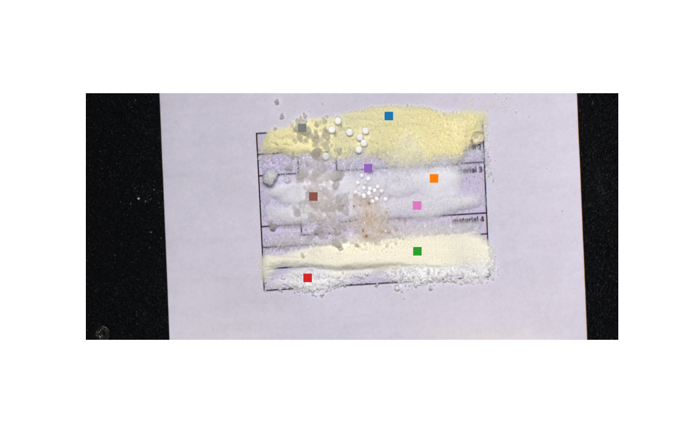
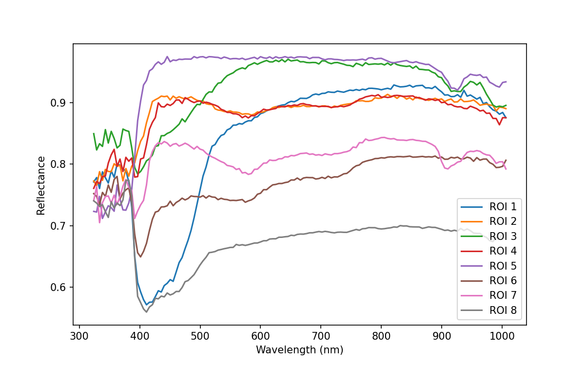
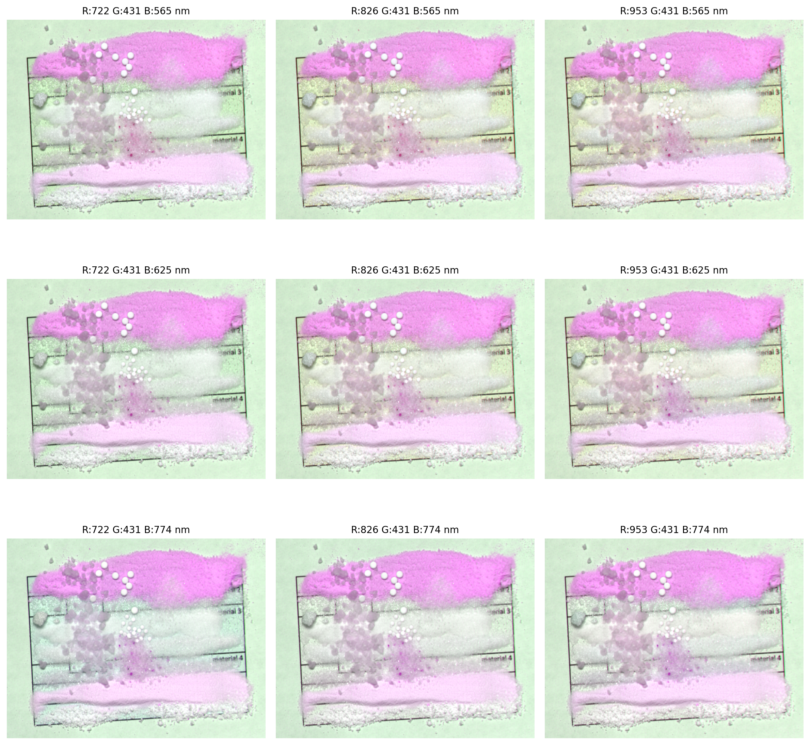

# White Powder Hyperspectral IR Analysis

This project analyzes white powder using an IR hyperspectral camera.
The dataset contains 256 spectral bands spanning 918–2532 nm.
White and dark reference correction is applied before extracting
reflectance spectra and identifying spectral bands that maximize
color differences between white powder samples.

## Results

<table>
<tr>
<th align="center">Selected ROIs</th>
<th align="center">ROI Reflectance Curves</th>
</tr>
<tr>
<td width="50%">

</td>
<td width="50%">

</td>
</tr>
</table>

The colored regions in **Selected ROIs** correspond to the same ROI curves shown in **ROI Reflectance Curves**.

### Discriminative Band Visualization


The animation visualizes RGB composites generated from selected
spectral bands. The bands are varied to identify combinations that
maximize visible color differences between white powder samples.

## VIS Results

The visible-spectrum analysis uses 135 bands spanning approximately
324–1006 nm. The results below show the selected ROIs, their reflectance
curves, and the evaluated RGB band combinations.

<table>
<tr>
<td>
<h3>Selected ROIs</h3>

</td>
<td>
<h3>ROI Reflectance Curves</h3>

</td>
</tr>
</table>

<p align="center">

</p>

The VIS results provide limited visual separation between the white powder
samples compared with the infrared analysis.

## Run locally

Install the required packages:

```bash
pip install numpy matplotlib spectral pillow
```

Place the three ENVI header files in `dataset/`:

```text
dataset/
├── ir med_sim_powder_scan_0551.hdr
├── WHITEREF_ir med_sim_powder_scan_0551.hdr
├── DARKREF_ir med_sim_powder_scan_0551.hdr
├── Medical_Img_Sim_scan_0128.hdr
├── WHITEREF_Medical_Img_Sim_scan_0128.hdr
└── DARKREF_Medical_Img_Sim_scan_0128.hdr
```

Run:

```bash
python White_Powder_IR.py
```

For the visible-spectrum analysis, run:

```bash
python white_Powder_VIS.py
```

The source hyperspectral data is not included in this repository.
