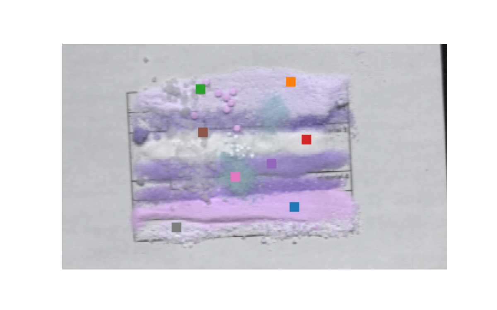
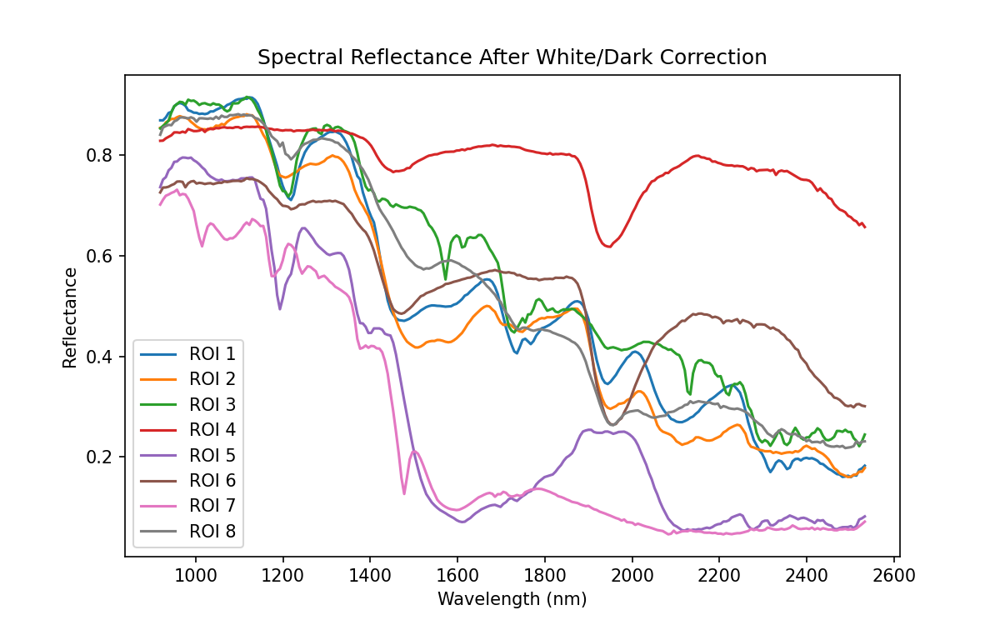

# White Powder Hyperspectral IR Analysis

This project analyzes white powder using hyperspectral infrared data
(918–2532 nm). It performs white/dark reference correction, interactive
pixel-spectrum inspection, and false-color wavelength visualization.

## Results

<table>
<tr>
<td>
<h3>Selected ROIs</h3>

</td>
<td>
<h3>ROI Reflectance Curves</h3>

</td>
</tr>
</table>

The colored regions in **Selected ROIs** correspond to the same ROI curves
shown in **ROI Reflectance Curves**.

### False-color wavelength combinations

### Wavelength animation


The animation changes the red, green, and blue channels independently using
10 nm wavelength steps within their selected spectral ranges.

## Run locally

Install the required packages:

```bash
pip install numpy matplotlib spectral pillow
```

Place the three ENVI header files in `dataset/`:

```text
dataset/
├── ir med_sim_powder_scan_0551.hdr
├── WHITEREF_ir med_sim_powder_scan_0551.hdr
└── DARKREF_ir med_sim_powder_scan_0551.hdr
```

Run:

```bash
python White_Powder_IR.py
```

The source hyperspectral data is not included in this repository.
